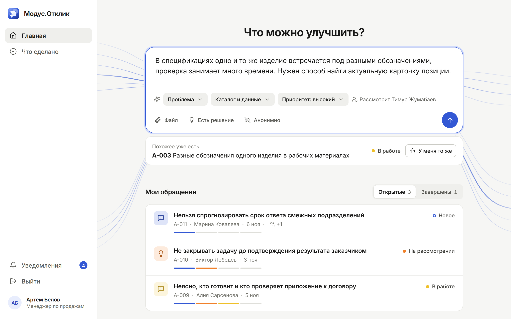
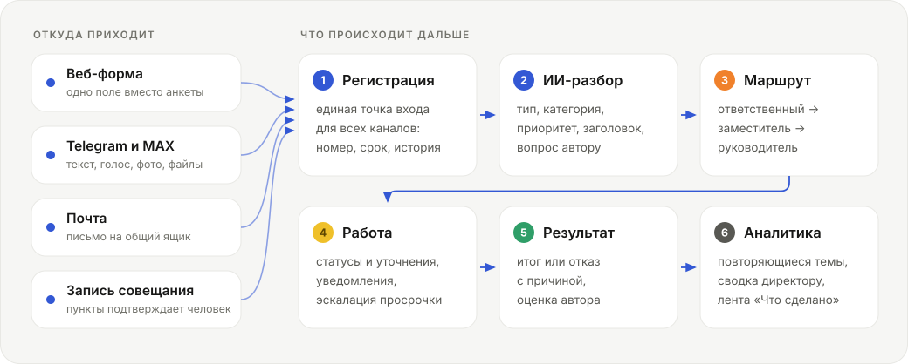
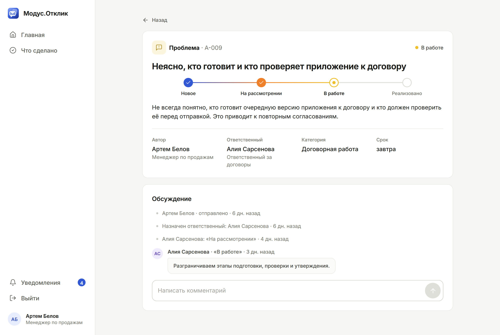
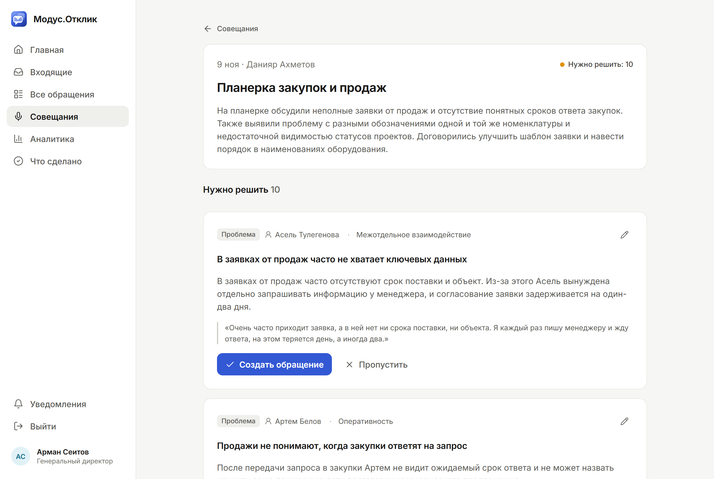
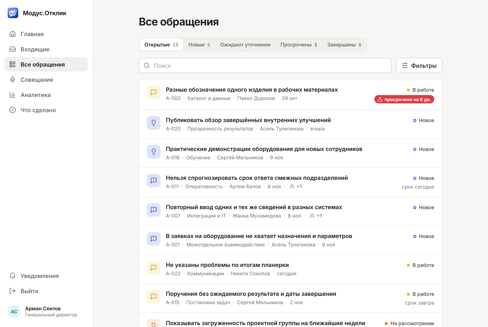
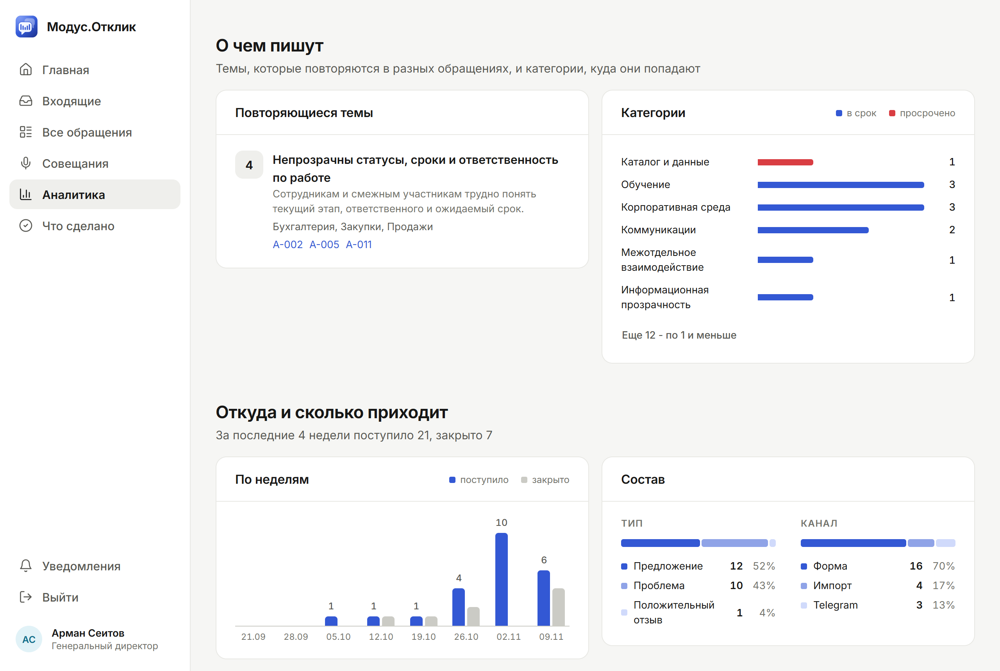
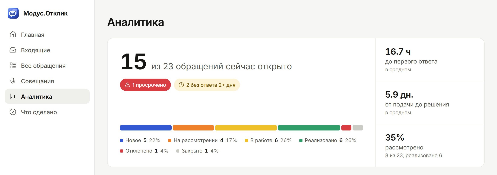
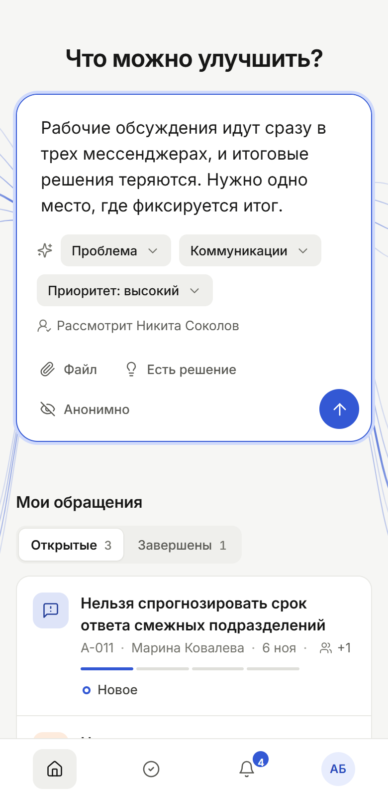

<div align="center">
  
  <h1>Модус.Отклик</h1>
  <p>
    <b>Проблемы и идеи сотрудников - в одном месте.</b><br>
    Сказанное в чате, в письме или на совещании становится обращением<br>
    с ответственным, сроком и результатом, который видит автор.
  </p>
  <p>
    <a href="https://modus-otklik.vercel.app"><b>Открыть демо</b></a> &nbsp;·&nbsp;
    <a href="#что-умеет">Что умеет</a> &nbsp;·&nbsp;
    <a href="#как-это-работает">Как работает</a> &nbsp;·&nbsp;
    <a href="#демо-за-пять-минут">Сценарий демо</a> &nbsp;·&nbsp;
    <a href="#запуск">Запуск</a>
  </p>
  <p>
    
    
    
    
    
    
    
  </p>
</div>

<p align="center">
  
</p>
<p align="center">
  <sub>Сотрудник пишет своими словами. Тип, категорию, приоритет и ответственного система подбирает сама,<br>а если о том же уже писали - предлагает присоединиться вместо дубля.</sub>
</p>

Работающий MVP системы обратной связи и предложений сотрудников для ГК «Модус Трейд» - решение хакатона
Pavlodar Hub (ноябрь 2026). Пять каналов приема, четыре роли, 18 категорий с маршрутами и сроками,
20 обращений из датасета организаторов в демо-данных.

## Зачем

Собственник компании описал задачу так: замечания и идеи приходят хаотично - письмом, репликой на совещании,
в телефонном разговоре. Чтобы понять, что требует улучшения, приходится вспоминать совещания по памяти.
Сотрудник, сказав о проблеме, считает, что ее решают, а о ней забыли. Со временем люди перестают предлагать.

| Что болит | Как отвечает Модус.Отклик |
|---|---|
| Замечания звучат где угодно, но не в системе | Обращение принимается там, где прозвучало: форма, Telegram, почта, **запись совещания** |
| Сказал о проблеме - и о ней забыли | У каждого обращения есть ответственный, срок и история. Ответственный в отпуске или срок истек - система сама передает вопрос дальше |
| Люди не видят результата и перестают писать | Автор видит этап, вопросы и итог или причину отказа. Вся компания видит ленту «Что сделано» |
| Руководитель держит картину в голове | Аналитика: что просрочено, что осталось без ответа, какие темы повторяются, короткая сводка |

## Как это работает

<p align="center">
  
</p>

Все каналы создают обращения через одну функцию `workflow.register()`, поэтому маршрут, срок, история и
уведомления одинаковы, откуда бы обращение ни пришло. Без ответственного оно не остается: если он отсутствует,
вопрос уходит заместителю, затем руководителю подразделения, в крайнем случае - администратору.

Этапы: `Новое → На рассмотрении → В работе → Реализовано`. Вне шкалы - «Ожидает уточнения», «Отклонено» и «Закрыто».
Отклонить обращение или отметить его реализованным без текста нельзя: автор всегда получает объяснение.

## Что умеет

| Кому | Что получает |
|---|---|
| **Сотрудник** | Одно поле вместо формы. Похожее обращение уже есть - «У меня то же» вместо дубля. Вложения, анонимная подача, этапы и история в карточке, ответы на уточнения. Оценка результата: «не решено» возвращает обращение в работу |
| **Ответственный** | Входящие по вкладкам (новые, ждут уточнения, просрочены), поиск и фильтры. Кнопки называют действие: «Уточнить», «Взять в работу», «Готово». Внутренние заметки, передача коллеге. Все то же - кнопками в Telegram |
| **Директор** | Картина целиком: открытые, просроченные и оставшиеся без первого ответа дольше 48 часов, время до ответа и до решения, нагрузка по ответственным. Повторяющиеся темы и сводка ИИ. Просроченное само поднимается к нему |
| **Администратор** | Категории, ответственные и сроки рассмотрения, роли и замещения, каналы приема, оргструктура из 1С:ЗУП, Битрикс24 или файла |

<table>
  <tr>
    <td width="50%" valign="top">
      <br>
      <sub><b>Карточка обращения.</b> Этапы, ответственный, срок и вся история в одном месте</sub>
    </td>
    <td width="50%" valign="top">
      <br>
      <sub><b>Совещание.</b> Проблемы, идеи, решения и поручения с дословной цитатой</sub>
    </td>
  </tr>
  <tr>
    <td valign="top">
      <br>
      <sub><b>Все обращения.</b> Вкладки по состоянию, поиск, фильтры и метки сроков</sub>
    </td>
    <td valign="top">
      <br>
      <sub><b>О чем пишут.</b> Одна первопричина глазами разных отделов, категории, динамика</sub>
    </td>
  </tr>
  <tr>
    <td colspan="2">
      <br>
      <sub><b>Экран директора.</b> Сколько открыто, что просрочено, как быстро отвечаем и сколько доведено до результата</sub>
    </td>
  </tr>
</table>

## Каналы приема



- **Веб-форма.** Одно поле для текста, вложения до 20 МБ, анонимно при желании. Работает на широком экране,
  в узком окне и на телефоне.
- **Telegram-бот.** Текст, голосовое, фото или файл становятся черновиком: бот показывает заголовок, категорию
  и ответственного, предлагает присоединиться к похожему. В систему обращение уходит после «Отправить».
  `/my` - свои обращения, `/inbox` - входящие ответственного, `/settings` - уведомления.
  По утрам - сводка ответственным, за сутки до срока - напоминание.
- **Telegram Mini App.** То же приложение внутри Telegram. Вход без пароля: сервер проверяет подпись
  данных запуска токеном бота. Нужен публичный https-адрес (`WEBAPP_URL`).
- **Почта.** Письмо на общий ящик (IMAP) становится обращением, автор определяется по адресу.
  Если ящик общий с другой почтой, `IMAP_TO` оставляет только письма на адрес обратной связи.
  Для демо есть имитация письма - тем же кодом, что разбирает настоящий ящик.
- **Совещания.** Аудио, видео, `.txt`, `.docx` или вставленный протокол. Система расшифровывает запись
  и выписывает пункты. Обращением пункт становится только после того, как человек его проверил.

Мессенджер привязывается к учетной записи одноразовым кодом из профиля - посторонний боту написать не может.
Оба бота работают через long polling: внешний адрес и вебхук не нужны.

<br clear="right">

## ИИ помогает, решает человек

- **Три взаимозаменяемых движка:** Claude (официальный SDK), любой OpenAI-совместимый API и правила.
  Ответ модели проверяется одной строгой схемой. Нет ключа, модель недоступна или отказалась отвечать -
  тот же результат строят правила. Регистрация, маршруты и история от ИИ не зависят.
- **Что делает ИИ:** готовит карточку обращения (тип, категория, приоритет, заголовок, уточняющий вопрос),
  выписывает пункты совещания с цитатами, собирает сводку и находит повторяющиеся темы -
  обращения с общей первопричиной, даже если они написаны разными словами в разных отделах.
- **Человек в контуре:** карточку можно поправить до отправки, пункт совещания - принять, изменить или пропустить.
- **Речь - на сервере компании.** faster-whisper работает локально: записи совещаний и голосовые наружу не уходят.
  Поиск похожих обращений тоже локальный.
- **Что уходит во внешний API** (и только если задан ключ): текст обращения или расшифровки, список категорий,
  для сводки - тексты открытых обращений без авторов. Вложения, имена авторов и оргструктура не передаются.
  Исключение - режим `SPEECH_MODE=api` для стендов без Whisper: там звук записи распознает OpenAI,
  и в окне загрузки это написано.
- **Закрытый контур:** `AI_MODE=rules` или `OPENAI_BASE_URL`, указывающий на локальную модель в сети компании.

## Роли и доступ

| Роль | Видит | Может |
|---|---|---|
| Сотрудник | свои обращения, ленту «Что сделано», заголовки похожих | подавать, отвечать на уточнения, присоединяться к чужим, оценивать результат |
| Руководитель | назначенные ему, обращения своих категорий и своего подразделения | вести обращения, разбирать совещания, смотреть аналитику по своей части |
| Директор | все | любое действие по любому обращению, сводка |
| Администратор | все | дополнительно: категории, маршруты, роли, замещения, каналы, оргструктура |

**Анонимность.** Имя и подразделение автора не видит никто, включая директора и администратора, и они не
раскрываются через фильтры. Автор при этом следит за статусом и отвечает на вопросы. Ограничение честное:
автор хранится в базе, поэтому анонимность защищена на уровне приложения, а не от прямого доступа к базе данных.

**Внутренние заметки** видны только тем, кто рассматривает обращение.

## 1С и Битрикс24

Оргструктура приходит из систем компании: источник отдает сотрудников и подразделения, система заводит новых,
обновляет должности и руководителей, отмечает отсутствующих (их обращения сразу уходят заместителю)
и отключает уволенных.

| Источник | Как подключается | Что берем |
|---|---|---|
| 1С:ЗУП | стандартный интерфейс OData, `ONEC_ODATA_URL` | сотрудники, подразделения, руководители, отпуска и командировки |
| Битрикс24 | входящий вебхук REST с правами `user` и `department`, `BITRIX_WEBHOOK_URL` | сотрудники без экстранета, подразделения, руководители |
| Файл | CSV или XLSX, шаблон в интерфейсе | ФИО, почта, должность, подразделение, руководитель, отсутствие, увольнение |

Синхронизация осторожна: «Проверить» показывает изменения без записи, «Применить» сохраняет и пишет в журнал.
Ничего не удаляется, роли не понижаются, администраторы не отключаются. Если источник вернул заметно меньше
людей и отключить пришлось бы больше 30%, синхронизация отказывается - это защита от неполной выгрузки.

> [!NOTE]
> Пока адрес системы не задан, работает встроенный эмулятор: код ходит в него тем же HTTP-клиентом,
> подменяется только транспорт. Запросы к Битрикс24 проверены на тестовом портале
> (`backend/scripts/bitrix_setup.py` заполняет его демо-оргструктурой). Имена объектов 1С взяты из типовой
> ЗУП 3 - в конкретной базе их нужно сверить по `$metadata`.

## Google Календарь и ИИ-агенты

**Срок в календаре.** Обращение ложится в Google Календарь полосой на весь срок - от дня регистрации до дедлайна.

- Без настроек: в карточке обращения рядом со сроком есть ссылка «в Google Календарь» - открывает готовое событие, остается нажать «Сохранить».
- С подключением (профиль -> Google Календарь): события ведутся сами у автора и у ответственного. Перенесли срок - полоса удлинилась, передали другому - событие переехало, закрыли - отмечено галочкой и обрезано днем закрытия. Работает одинаково для формы, бота, почты и агента: синхронизация привязана к записи в базу, а не к отдельным экранам.

Для подключения нужен OAuth-клиент Google типа «Веб-приложение» с адресом возврата `<APP_URL>/api/calendar/google/callback` и включенным Google Calendar API; ключи - в `GOOGLE_CLIENT_ID` и `GOOGLE_CLIENT_SECRET`. Запрашивается только доступ к событиям.

**ИИ-агент (MCP).** Общий список обращений подключается к любому агенту с поддержкой MCP - Claude, Cursor, ChatGPT и другим. Сотрудник обсуждает задачу со своим помощником, тот уточняет детали, сверяется с похожими обращениями, показывает, кто будет отвечать и к какому сроку, и после согласия человека отправляет обращение в общий список от его имени.

Подключение - в профиле, блок «Доступ для агента»: файл навыка `SKILL.md` (скопировать или скачать; ключа в нем нет) и кнопка «Копировать промпт для агента». Промпт сотрудник вставляет своему агенту: в нем личный ключ (показывается один раз), навык и шаги подключения. Агент без MCP вызывает тот же сервер обычным HTTP-запросом - пример есть в навыке. Сервер: `<APP_URL>/api/mcp` (Streamable HTTP, ключ в заголовке `Authorization: Bearer` или последним сегментом адреса).

| Инструмент | Что делает |
| --- | --- |
| `get_guide` | Кто я, типы, приоритеты, категории с ответственными и сроками |
| `find_similar` | Похожие обращения, чтобы не создавать дубль |
| `draft_task` | Примерка черновика: тип, категория, ответственный, срок, чего не хватает. Ничего не создает |
| `submit_task` | Регистрация в общем списке - тем же кодом, что форма и бот |
| `list_tasks`, `get_task` | Мои, входящие и доступные обращения, обсуждение по номеру |
| `support_task` | «У меня то же самое» вместо дубля |
| `get_channels` | Telegram-бот (привязан ли), адрес ящика для обращений письмом; администратору - состояние каналов |
| `connect_messenger`, `disconnect_messenger` | Привязать бота без сайта: агент выдает ссылку с кодом, сотрудник нажимает «Старт» |
| `list_meetings`, `get_meeting` | Совещания, их разбор и пункты; у черновиков видно, кто станет ответственным и какой срок |
| `add_meeting` | Загрузить протокол текстом, файлом (base64) или ссылкой на запись - речь распознается на сервере |
| `accept_meeting_item`, `reject_meeting_item`, `retry_meeting` | Подтвердить пункт (обращение уходит по маршруту, можно указать автора), отклонить, разобрать заново |
| `intake_email`, `check_mailbox` | Администратору: зарегистрировать письмо как обращение, забрать новые письма из ящика сразу |

Совещания доступны руководителям, директору и администратору, почта - администратору: агент видит ровно то, что сотрудник видит в интерфейсе, права те же. Ключ хранится в базе только отпечатком, новый ключ отменяет прежний.

## Демо за пять минут

Стенд: **https://modus-otklik.vercel.app**. На экране входа четыре роли; под конкретным человеком - вкладка
«Человек». Все люди вымышлены, обращения A-001...A-020 взяты из датасета организаторов.

1. **Сотрудник подает обращение.** Напишите текст на главной - под ним появятся тип, категория, приоритет
   и тот, кто будет рассматривать. Если похожее уже есть, система предложит «У меня то же».
2. **Руководитель ведет обращение.** Войдите как Алия Сарсенова → «Входящие» → откройте обращение →
   «Уточнить». Ответьте под автором, затем «Взять в работу» и «Готово».
3. **Замещение.** Администратор → «Настройки» → «Сотрудники» → отметьте Тимура Жумабаева отсутствующим.
   На вкладке «Кто что разбирает» видно, что «Каталог и данные» теперь уходит заместителю.
4. **Совещание.** Директор → «Совещания» → «Загрузить запись» → `demo/планерка_закупки_и_продажи.txt`.
   У любого пункта нажмите «Создать обращение» - он уйдет ответственному со сроком и историей.
5. **Директор.** «Аналитика»: что просрочено, что без ответа, повторяющиеся темы, сводка.
6. **Каналы и оргструктура.** Администратор → «Настройки» → «Каналы» → «Принять письмо»;
   «1С и Битрикс24» → «Проверить».

<details>
<summary>Чем стенд отличается от своего сервера</summary>

<br>

Сайт - статика из `frontend/dist` на Vercel. Все запросы `/api/...` (включая MCP для ИИ-агентов)
Vercel передает на сервер в Railway (`Dockerfile`, том `/data`): там одна постоянная база, бот и почта.
Поэтому обращения, настройки и ключи агентов не пропадают при новом деплое.

- **Совещания.** Аудио и видео распознает OpenAI: браузер достает звук из файла (до 600 МБ), режет его
  по паузам на части до двух минут и отправляет по одной. Протокол текстом принимается всегда.
- `api/index.py` и снимок `api/demo.db` - запасной вариант без своего сервера: API как Python-функция
  Vercel, база во временной папке и сбрасывается при каждом деплое. Для него верните в `vercel.json`
  функцию `api/index.py` вместо переадресации на Railway.

</details>

## Запуск

Нужны Python 3.11+ и Node.js 20+. Команды для Windows; на Linux и macOS - `.venv/bin/...` и `cp`.

```bash
cd backend
python -m venv .venv
.venv\Scripts\pip install -r requirements.txt
copy .env.example .env
.venv\Scripts\python -m uvicorn app.main:app --port 8010
```

```bash
cd frontend
npm install
npm run dev
```

Интерфейс откроется на http://127.0.0.1:5180, база при первом запуске заполнится демо-данными.
**Ни одна настройка не обязательна:** без ключей ИИ-разбор идет по правилам, а оргструктура берется из эмулятора.

| Задача | Команда |
|---|---|
| Один процесс вместо двух | `npm run build` во `frontend` - бэкенд сам раздаст интерфейс на порту 8010 |
| Один контейнер | `docker build -t modus-otklik .`, затем `docker run -p 8000:8000 -v modus-data:/data modus-otklik` - API, боты, фоновые задачи и интерфейс в одном образе, данные в томе `/data` |
| Пересоздать демо-данные | `python -m app.seed --reset` из `backend` |
| Тесты | `python -m pytest tests -q` из `backend` |

<details>
<summary>Настройки в <code>backend/.env</code></summary>

<br>

| Переменная | Зачем |
|---|---|
| `ANTHROPIC_API_KEY`, `LLM_MODEL` | ИИ-разбор через Claude. Если заданы оба ключа, используется Claude |
| `OPENAI_API_KEY`, `OPENAI_MODEL`, `OPENAI_BASE_URL` | OpenAI или локальная модель с OpenAI-совместимым API |
| `AI_MODE=rules` | принудительно отключить модель |
| `WHISPER_MODEL`, `WHISPER_DEVICE` | распознавание речи: `small`, `medium`, `large-v3`. Первая загрузка модели - от 0,5 до 3 ГБ |
| `SPEECH_MODE`, `TRANSCRIBE_MODEL` | `local` - Whisper на сервере, `api` - через OpenAI, `off` - только текст |
| `TELEGRAM_BOT_TOKEN`, `WEBAPP_URL` | бот и Mini App |
| `GOOGLE_CLIENT_ID`, `GOOGLE_CLIENT_SECRET`, `APP_URL` | автоматическое ведение сроков в Google Календаре |
| `IMAP_HOST`, `IMAP_USER`, `IMAP_PASSWORD`, `IMAP_TO` | почтовый ящик обратной связи; `IMAP_TO` - брать только письма на этот адрес |
| `ONEC_ODATA_URL`, `ONEC_USER`, `ONEC_PASSWORD`, `BITRIX_WEBHOOK_URL` | источники оргструктуры |
| `ORG_SYNC_SOURCE`, `ORG_SYNC_HOURS` | синхронизация по расписанию |
| `TZ_OFFSET_HOURS`, `DIGEST_HOUR` | часовой пояс компании и час утренней сводки |
| `DEMO_LOGIN` | быстрый вход по ролям; в рабочей установке - `0` |

Распознавание на видеокарте NVIDIA в разы быстрее: `pip install nvidia-cublas-cu12 "nvidia-cudnn-cu12>=9,<10"`.
Без этих библиотек Whisper сам переключается на процессор.

Для Mini App на своем компьютере достаточно туннеля к порту 8010 (например,
`cloudflared tunnel --url http://127.0.0.1:8010`) и собранного фронтенда.

</details>

## Как устроено

| Слой | Чем сделан |
|---|---|
| Бэкенд | Python, FastAPI, SQLAlchemy 2, SQLite. Один процесс, фоновые потоки для ботов, почты и контроля сроков |
| Фронтенд | React 18, Vite, React Router. Собранный интерфейс раздает тот же сервер |
| ИИ | Anthropic SDK или OpenAI-совместимый API, pydantic-схема ответа, запасные правила |
| Речь | faster-whisper и ffmpeg на сервере; на бессерверном стенде - нарезка записи в браузере |
| Доступ | JWT, пароли PBKDF2, проверка подписи Telegram Mini App, права по ролям на каждом запросе |

<details>
<summary>Структура репозитория</summary>

```
backend/app/
  workflow.py   регистрация, маршруты, статусы, сроки, уведомления - единая точка входа
  ai.py         Claude, OpenAI и правила: разбор, совещания, сводка, похожие
  meetings.py   расшифровка и разбор совещаний
  bots.py       Telegram-бот: диалог отдельно от транспорта
  mail.py       прием писем по IMAP
  orgsync.py    оргструктура из 1С:ЗУП, Битрикс24, CSV и XLSX
  mocks.py      эмуляторы 1С (OData) и Битрикс24 (REST)
  api.py        REST API
  models.py     данные
  security.py   пароли, JWT, подпись Telegram Mini App
  seed.py       демо-данные из датасета
backend/tests/    20 тестов: сценарии датасета, боты, почта, Mini App, синхронизация
backend/scripts/  заполнение тестового портала Битрикс24
frontend/src/     интерфейс; design/tokens.css - токены, speech.js - нарезка записи в браузере
api/              запасной вариант API на Vercel без своего сервера
Dockerfile        сервер целиком одним контейнером
demo/             учебный протокол совещания и сценарий записи ролика
docs/             скриншоты
```

</details>

**Дизайн-система.** Интерфейс построен на токенах из `frontend/src/design/tokens.css`: нейтральная серая основа,
синий акцент для действий, своя шкала цвета для этапов обращения и отдельные цвета ролей. Цвет не работает один -
рядом всегда слово или значок. Статус называется и окрашен одинаково на всех экранах, в аналитике и в ботах.
Краткий справочник: `docs/design-system.md`.

**Тесты.** 20 сквозных тестов на чистой временной базе, без сети и ключей: сценарии из раздела 4 датасета,
замещение, анонимность, совещание → обращения, диалог в боте, вход в Mini App, почта, синхронизация оргструктуры.

## Границы MVP и что дальше

**Что стоит знать сейчас**

- Учетные записи демонстрационные, вход кнопкой роли. В рабочей установке - `DEMO_LOGIN=0`.
- Говорящих на записи система по голосу не различает: имя берется из расшифровки, если оно там прозвучало.
- Модель может ошибиться в деталях пункта совещания, поэтому у каждого пункта есть цитата и он ждет подтверждения.
- Без ключа модели повторяющиеся темы находятся только по почти дословным совпадениям, голосам коллег и категориям.
- Час записи на процессоре распознается десятки минут, на видеокарте - минуты.
- Один сервер и SQLite, без очереди задач. Для компании такого размера этого достаточно; PostgreSQL и резервные копии - задача пилота.
- Письмо с незнакомого адреса регистрируется без автора в системе - уточнить у него можно только лично.

**Дальше**

1. **Пилот, 1-2 месяца.** Вход через Битрикс24, настоящие бот и почтовый ящик, PostgreSQL, резервное копирование.
   Метрики: доля обращений с первым ответом за 48 часов, доля закрытых с записанным итогом, число обращений
   на сотрудника в месяц, доля пришедших не через форму.
2. **Расширение.** Задача в Битрикс24 при переходе обращения «В работу» и обратный сигнал о ее закрытии.
   Привязка обращения к заказу или номенклатуре 1С УТ (только чтение справочников). Ответ автору письмом,
   автоматический прием записей из календаря, определение говорящих, ежемесячная рассылка «Что сделано».
3. **Отдельная проработка.** Клиентская обратная связь и NPS, опросы сотрудников, локальная языковая модель
   в контуре компании.
